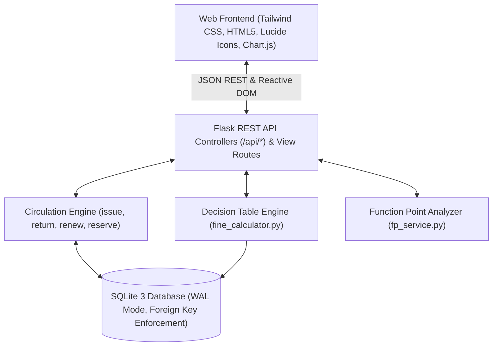

# Athena Library Management System (LMS)
### Production-Ready Web Application & Software Engineering Minor Project Dossier

[](https://www.python.org/)
[](https://flask.palletsprojects.com/)
[](docs/RENDER_DEPLOYMENT.md)
[-brightgreen.svg)](tests/)
[](docs/SPMP.md)
[](docs/FUNCTION_POINT_ANALYSIS.md)

---

## 1. Project Overview
Athena LMS is a full-stack, enterprise-grade **Library Management System Web Application** engineered in strict compliance with the **Iterative Waterfall Software Engineering curriculum** outlined in [`Software_Engineering_Minor_Projects`](Software_Engineering_Minor_Projects).

The system seamlessly combines academic rigor with an intuitive, modern responsive interface, featuring automated circulation workflows, multi-tier patron management, a real-time **Decision Table Rule Engine for Overdue Fines**, and an interactive in-app **Function Point Analysis Estimator**.

---

## 2. Key Academic Syllabus Deliverables

| Syllabus Focus Area | Documentation | In-App Interactive Feature |
| :--- | :--- | :--- |
| **Decision Table for Fines** | [`docs/DECISION_TABLE_FINES.md`](docs/DECISION_TABLE_FINES.md) | **Live Fine Sandbox & Simulator** at `/fines` |
| **Function Point (FP) Count** | [`docs/FUNCTION_POINT_ANALYSIS.md`](docs/FUNCTION_POINT_ANALYSIS.md) | **Dynamic 14 GSC Estimator** at `/reports` |
| **Data Flow Diagrams (DFD)** | [`docs/DFD_AND_ARCHITECTURE.md`](docs/DFD_AND_ARCHITECTURE.md) | **Interactive Mermaid Visualizer** at `/se-dossier` |
| **Requirements Specification** | [`docs/SRS.md`](docs/SRS.md) | Complete IEEE 830-1998 compliant specification |
| **Project Management Plan** | [`docs/SPMP.md`](docs/SPMP.md) | WBS, Gantt Schedule, and Risk Exposure Matrix |
| **Governance & Working Rules** | [`docs/MEETING_MINUTES_AND_LOGS.md`](docs/MEETING_MINUTES_AND_LOGS.md) | 10 Weeks Minutes, CCB Change Requests, Contribution Logs |
| **Testing & Defect Ledger** | [`docs/TEST_PLAN_AND_DEFECT_LOG.md`](docs/TEST_PLAN_AND_DEFECT_LOG.md) | 31 Automated Pytest cases with Defect Lifecycle |
| **Operations Manual & Viva Guide**| [`docs/USER_MANUAL.md`](docs/USER_MANUAL.md) | Patron/Librarian workflows + 11 Viva Voce Q&As |

---

## 3. System Architecture & Features

### Architecture Diagram


### Core Web Capabilities
1. **Circulation Desk (`/circulation`)**:
   - Issue books with patron quota and fine debt validation.
   - Return processing with automatic physical condition inspection (`Normal`, `Minor Damage`, `Severe Damage`, `Lost`).
   - Loan renewals (enforcing statutory 2-renewal cap and active reservation checks).
   - Waitlist reservations on out-of-stock titles.
2. **Catalog Inventory (`/books`)**:
   - Live instant keyword search (Title, Author, ISBN, Category).
   - Multi-tier classification: `Standard` (1.0x), `Course Reserve` (2.0x), `Rare/Reference` (3.0x).
   - Stock control and deletion safety constraints.
3. **Patron Directory (`/members`)**:
   - Role-based profiles: `Student` (4 books, 14 days), `Faculty` (8 books, 30 days), `Guest` (2 books, 7 days).
   - Automated account holds and suspension when unpaid fines exceed policy threshold ($15.00).
4. **Decision Table Simulator (`/fines`)**:
   - Real-time interactive sandbox allowing testing of all 27 canonical decision rules.
   - Comprehensive ledger with digital payment settlement.
5. **Software Engineering Dossier Hub (`/se-dossier`)**:
   - In-app interactive presentation of Context Level 0, Level 1, and Level 2 DFDs rendered via Mermaid.js.

---

## 4. Quick Start & Local Execution

### Prerequisites
- Python 3.10+ (Tested on Python 3.15)
- Git

### Installation & Launch
```bash
# 1. Clone repository (or navigate to project folder)
cd "Library Management System"

# 2. Install dependencies
pip install -r requirements.txt

# 3. Launch application server
python run.py
```
Open your browser and navigate to:
**`http://127.0.0.1:5000/`**

---

## 5. Automated Verification & Testing

The application includes an exhaustive test suite covering unit logic, boundary value analysis, database transactions, and REST endpoints:

```bash
# Run complete test suite with verbose output
python -m pytest -v
```

### Test Suite Summary
- **Total Test Cases**: 31
- **Passed**: 31 (100%)
- **Execution Time**: ~0.7 seconds
- **Key Coverage**:
  - `test_fine_calculator.py`: 12 test suites verifying every branch of the Decision Table, boundary values, grace periods, and fine caps.
  - `test_circulation.py`: 8 test suites verifying checkouts, duplicate restrictions, out-of-stock handling, returns, renewals, and reservations.
  - `test_catalog_and_members.py`: 4 test suites verifying search, deletion protection, eligibility, and fine settlement.
  - `test_api_routes.py`: 7 integration test suites validating all RESTful endpoints.

---

## 6. Production Deployment & Web Publishing

### Option A: One-Click Cloud Deployment on Render (Recommended)
This repository includes a [`render.yaml`](render.yaml) blueprint specification for automated free cloud hosting:
1. Log in to [Render Dashboard](https://dashboard.render.com/).
2. Select **Blueprints** &rarr; Connect `itscreeperx03/Library-Management-System`.
3. Click **Apply** to deploy live!
*See detailed step-by-step instructions in [`docs/RENDER_DEPLOYMENT.md`](docs/RENDER_DEPLOYMENT.md).*

### Option B: WSGI Server (Waitress on Windows / Gunicorn on Linux)
```bash
# Using Waitress (Windows production server)
waitress-serve --port=5000 wsgi:application

# Using Gunicorn (Linux / macOS / Cloud)
gunicorn --bind 0.0.0.0:5000 wsgi:application
```

### Option B: Docker Container
```bash
# Build production Docker image
docker build -t athena-lms .

# Run container
docker run -d -p 8080:8080 --name lms-app athena-lms
```
Navigate to `http://localhost:8080/`.

---

## 7. REST API Reference

| Method | Endpoint | Description |
| :--- | :--- | :--- |
| `GET` | `/api/books` | Retrieve books catalog with optional query, category, or tier filters |
| `POST` | `/api/books` | Register new book acquisition |
| `DELETE`| `/api/books/<id>` | Delete book (blocked if active loans exist) |
| `GET` | `/api/members` | Retrieve patrons with active loans and outstanding fines |
| `POST` | `/api/members` | Enroll new student, faculty, or guest member |
| `POST` | `/api/circulation/issue` | Checkout a book to a patron |
| `POST` | `/api/circulation/return`| Return book and assess fine via Decision Table |
| `POST` | `/api/circulation/renew` | Extend loan duration (max 2 renewals) |
| `POST` | `/api/circulation/reserve`| Queue reservation for unavailable book |
| `POST` | `/api/fines/simulate` | Live Decision Table simulation payload |
| `GET` | `/api/fines/decision-matrix` | Complete 27-rule canonical matrix |
| `GET` | `/api/se/function-points` | Albrecht / IFPUG FP count calculation |
| `GET` | `/api/dashboard/stats` | Live operational and circulation statistics |

---

## 8. Team Roles & Academic Attribution
*Developed under the Iterative Waterfall Software Engineering Model:*
- **Project Manager / Scrum Master**: SPMP, WBS, Scheduling, Risk Management
- **Systems Analyst**: IEEE 830 SRS, Decision Table for Fines, FP Count Analysis
- **Designer & Lead Developer**: Relational Schema, DFDs, REST API, Web Architecture
- **QA & Security Auditor**: IEEE 829 Test Plan, Pytest Automation, Defect Remediation
