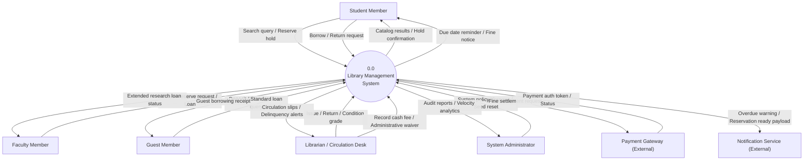
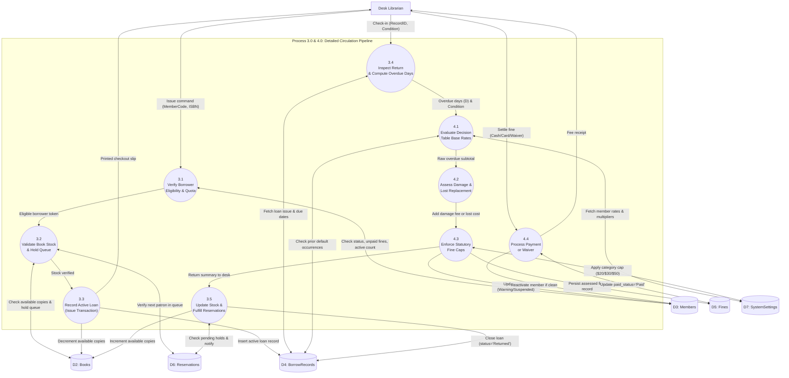
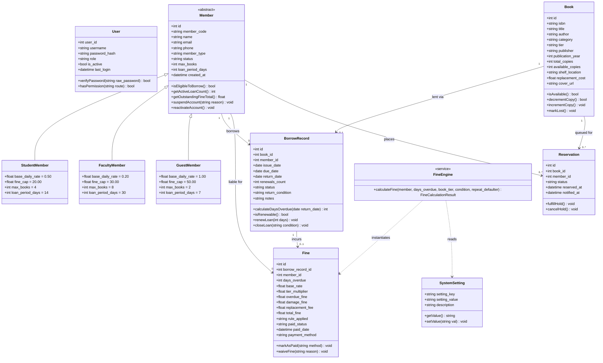
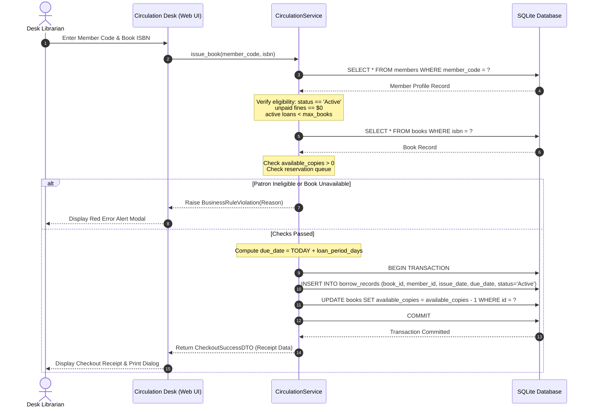
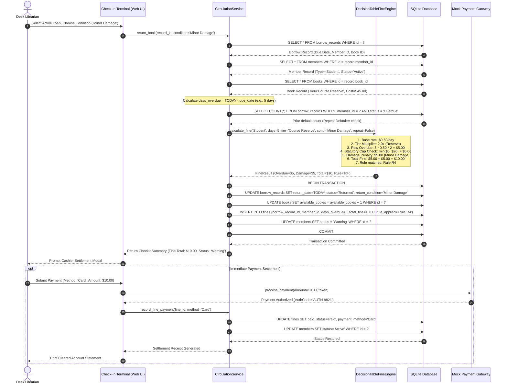
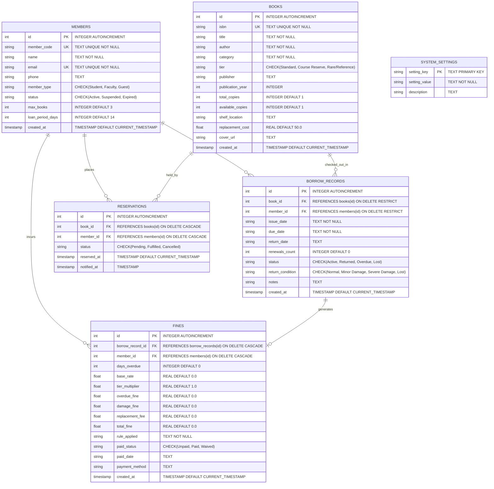

# System Architecture & Data Flow Diagrams (DFD)
## Library Management System (LMS)
**Document Type:** Technical Architecture, Data Flow & UML Design Specification  
**Project Special Syllabus Focus:** DFD Level 0, Level 1, Level 2, UML Class & Sequence Diagrams, ERD  
**Standard:** IEEE Std 1016-2009 Software Design Descriptions  
**Version:** 1.0.0  
**Date:** November 2026  

---

## Table of Contents
1. [Architectural Overview & Structural Decomposition](#1-architectural-overview--structural-decomposition)
   - 1.1 Three-Tier Layered Architecture
   - 1.2 Module Decomposition
2. [Data Flow Diagrams (DFD)](#2-data-flow-diagrams-dfd)
   - 2.1 Context Level 0 DFD (System Boundary)
   - 2.2 Level 1 DFD (Subsystem Decomposition)
   - 2.3 Level 2 DFD (Process 3.0: Issue, Return & Fine Engine)
3. [Unified Modeling Language (UML) Class Diagram](#3-unified-modeling-language-uml-class-diagram)
   - 3.1 Class Model & Design Patterns
   - 3.2 Mermaid Class Diagram
4. [UML Dynamic Sequence Diagrams](#4-uml-dynamic-sequence-diagrams)
   - 4.1 Sequence Diagram: Book Checkout (Issue Transaction)
   - 4.2 Sequence Diagram: Book Return with Overdue Fine & Damage Assessment
5. [Entity-Relationship Diagram (ERD)](#5-entity-relationship-diagram-erd)
   - 5.1 Relational Data Schema & Integrity Constraints
   - 5.2 Mermaid Entity-Relationship Diagram

---

## 1. Architectural Overview & Structural Decomposition

### 1.1 Three-Tier Layered Architecture
The Library Management System is architected according to a decoupled **Three-Tier Architectural Pattern**, ensuring separation of concerns between presentation, domain business logic, and transactional persistence:

```
┌────────────────────────────────────────────────────────────────────────┐
│                        PRESENTATION LAYER (UI)                         │
│  • HTML5 Semantic Templates & CSS3 Glassmorphic Styling                │
│  • Client-side validation & Barcode keyboard-wedge handler             │
│  • Chart.js Interactive Analytics & Responsive DataTables              │
└───────────────────────────────────┬────────────────────────────────────┘
                                    │ HTTP / REST / JSON Payloads
                                    ▼
┌────────────────────────────────────────────────────────────────────────┐
│                      BUSINESS LOGIC LAYER (SERVER)                     │
│  • Authentication & Role-Based Access Control Middleware               │
│  • Catalog & Inventory Management Service                              │
│  • Circulation Engine (Checkout, Renewal, Reservation Queue)           │
│  • Formal 16-Rule Decision Table Fine & Penalty Assessment Engine      │
│  • Delinquency Auditor & Overdue Dispatcher                            │
└───────────────────────────────────┬────────────────────────────────────┘
                                    │ SQLite3 WAL-Mode DB-API
                                    ▼
┌────────────────────────────────────────────────────────────────────────┐
│                       DATA PERSISTENCE LAYER                           │
│  • Relational Tables: members, books, borrow_records, fines,           │
│                       reservations, system_settings, users             │
│  • Foreign Key referential integrity (`ON DELETE RESTRICT/CASCADE`)   │
└────────────────────────────────────────────────────────────────────────┘
```

---

## 2. Data Flow Diagrams (DFD)

Data Flow Diagrams model the movement, transformation, and storage of information through the system without imposing sequential programming order (using standard DeMarco & Yourdon notation).

### 2.1 Context Level 0 DFD (System Boundary)
The Context Diagram establishes the total system boundary, illustrating the external entities (actors and external systems) that interface directly with the centralized Library Management System.



---

### 2.2 Level 1 DFD (Subsystem Decomposition)
The Level 1 DFD decomposes the system into five primary functional processes, interconnected via seven canonical data stores:
- **`D1: Users`** (Staff accounts and roles)
- **`D2: Books`** (Bibliographic catalog and physical copy counts)
- **`D3: Members`** (Patron profiles, categories, and account status)
- **`D4: BorrowRecords`** (Circulation ledger: active loans, history, returns)
- **`D5: Fines`** (Invoiced fines, fee breakdowns, payment records)
- **`D6: Reservations`** (Hold queues for checked-out items)
- **`D7: SystemSettings`** (Dynamic institutional fine rates, caps, loan days)

```mermaid
flowchart TD
    subgraph ExternalEntities ["External Entities"]
        UserEntity["Patron / Staff User"]
        LibrarianEntity["Desk Librarian"]
        AdminEntity["Administrator"]
        GatewayEntity["Payment Gateway"]
    end

    subgraph Processes ["Subsystem Functional Processes"]
        P1(("1.0<br/>User Authentication<br/>& Access Control"))
        P2(("2.0<br/>Catalog & Inventory<br/>Management"))
        P3(("3.0<br/>Circulation Engine<br/>(Issue / Return)"))
        P4(("4.0<br/>Decision-Table Fine<br/>& Penalty Engine"))
        P5(("5.0<br/>Reporting, Auditing<br/>& Analytics"))
    end

    subgraph DataStores ["Data Stores"]
        D1[("D1: Users")]
        D2[("D2: Books")]
        D3[("D3: Members")]
        D4[("D4: BorrowRecords")]
        D5[("D5: Fines")]
        D6[("D6: Reservations")]
        D7[("D7: SystemSettings")]
    end

    %% Process 1.0 Flows
    UserEntity -->|"Login credentials"| P1
    P1 <-->|"Verify hash & role"| D1
    P1 -->|"Session token / Role claims"| UserEntity

    %% Process 2.0 Flows
    UserEntity -->|"Search query"| P2
    AdminEntity -->|"Add / Edit book metadata"| P2
    P2 <-->|"Query / Update catalog"| D2
    P2 -->|"Catalog search results"| UserEntity

    %% Process 3.0 Flows
    LibrarianEntity -->|"Issue loan / Return book"| P3
    P3 <-->|"Verify member status & quota"| D3
    P3 <-->|"Check stock & update copies"| D2
    P3 -->|"Create / Close loan entry"| D4
    P3 <-->|"Queue / Fulfill hold"| D6
    P3 -->|"Circulation receipt"| LibrarianEntity
    P3 -->|"Return condition & overdue days"| P4

    %% Process 4.0 Flows
    P4 <-->|"Read policy rates & caps"| D7
    P4 <-->|"Check prior default history"| D4
    P4 -->|"Persist fine assessment"| D5
    P4 -->|"Update member suspension"| D3
    GatewayEntity <-->|"Online payment reconciliation"| P4
    P4 -->|"Payment receipt & cleared status"| LibrarianEntity

    %% Process 5.0 Flows
    AdminEntity -->|"Report request parameters"| P5
    P5 <--|"Read circulation data"| D4
    P5 <--|"Read fee balances"| D5
    P5 <--|"Read catalog turnover"| D2
    P5 -->|"Delinquency report & graphs"| AdminEntity
```

---

### 2.3 Level 2 DFD (Process 3.0: Issue, Return & Fine Engine)
The Level 2 DFD provides an explosive decomposition of the mission-critical circulation and fine assessment pipeline (combining Processes 3.0 and 4.0):



---

## 3. Unified Modeling Language (UML) Class Diagram

### 3.1 Class Model & Design Patterns
The domain model applies standard Object-Oriented principles (Encapsulation, Polymorphism, Single Responsibility):
- **Inheritance / Specialization:** `Member` serves as the abstract base for `StudentMember`, `FacultyMember`, and `GuestMember`, encapsulating policy parameters (`max_books`, `loan_period_days`, `fine_cap`, `base_rate`).
- **Composition & Association:** A `BorrowRecord` associates exactly one `Member` with one `Book`. An overdue or damaged return generates a compositionally bound `Fine` entity.
- **Service Layer Pattern:** Controller methods delegate business rules to stateless singleton services (`CirculationService`, `FineEngine`).

### 3.2 Mermaid Class Diagram



---

## 4. UML Dynamic Sequence Diagrams

### 4.1 Sequence Diagram: Book Checkout (Issue Transaction)
This sequence captures the interaction between the Desk Librarian, the web presentation layer, the circulation business service, and database persistence during a routine checkout:



---

### 4.2 Sequence Diagram: Book Return with Overdue Fine & Damage Assessment
This sequence demonstrates the execution of the Decision Table Fine Engine when a book is checked in late with physical damage:



---

## 5. Entity-Relationship Diagram (ERD)

### 5.1 Relational Data Schema & Integrity Constraints
The persistence layer contains six core relational tables engineered with strict foreign key constraints:
- **`MEMBERS`**: Stores library patrons with unique email and member codes.
- **`BOOKS`**: Bibliographic entries with ISBN unique keys, available copy inventory, and catalog tiers.
- **`BORROW_RECORDS`**: M:N junction table between `MEMBERS` and `BOOKS` with loan status, issue/due dates, and return condition audit.
- **`FINES`**: 1:1 / 1:M financial ledger recording mathematical fine breakdowns linked to circulation loans.
- **`RESERVATIONS`**: Waitlist queue resolving holds on zero-stock titles.
- **`SYSTEM_SETTINGS`**: Dynamic institutional configuration key-value storage.

### 5.2 Mermaid Entity-Relationship Diagram


