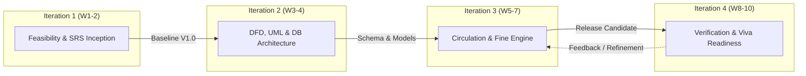
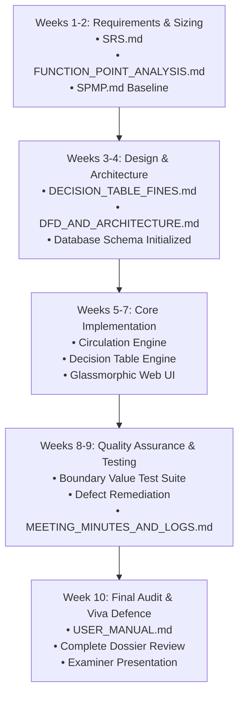

# Software Project Management Plan (SPMP)
## Library Management System (LMS)
**Document Standard:** IEEE Std 1058-1998 Project Management Plan  
**Life Cycle Model:** Iterative Waterfall Model  
**Version:** 1.0.0  
**Date:** November 2026  
**Status:** Approved Baseline  

---

## Table of Contents
1. [Introduction & Project Objectives](#1-introduction--project-objectives)
   - 1.1 Project Summary
   - 1.2 Purpose, Scope & Deliverables
   - 1.3 Assumptions & Constraints
2. [Project Organization & Team Roles](#2-project-organization--team-roles)
   - 2.1 Team Structure & Role Assignment
   - 2.2 Working Rules & Operational Norms
3. [Managerial Process & Life Cycle Model](#3-managerial-process--life-cycle-model)
   - 3.1 Life Cycle Rationale: The Iterative Waterfall Model
   - 3.2 Iteration Mapping & Phase Milestones
4. [Work Breakdown Structure (WBS)](#4-work-breakdown-structure-wbs)
   - 4.1 Hierarchical WBS Dictionary
5. [Project Schedule & Milestone Roadmap](#5-project-schedule--milestone-roadmap)
   - 5.1 Project Milestones (M1 to M7)
   - 5.2 Phase Schedule & Deliverables Roadmap
6. [Risk Management Plan & Matrix](#6-risk-management-plan--matrix)
   - 6.1 Risk Identification & Assessment Framework
   - 6.2 Master Risk Matrix & Mitigation Strategies
7. [Quality Assurance & Configuration Management](#7-quality-assurance--configuration-management)
   - 7.1 Definition of Done (DoD)
   - 7.2 Peer Review Protocols
   - 7.3 Change Control Procedure

---

## 1. Introduction & Project Objectives

### 1.1 Project Summary
The **Library Management System (LMS)** project aims to develop a robust, modern, web-based digital circulation and inventory management platform for academic institutions. Developed in strict compliance with the **Minor Projects in Software Engineering** curriculum guidelines, the system emphasizes mathematical precision in business logic (Decision Table for Fines), standardized software sizing (Function Point Analysis), and complete architectural decomposition (Level 0, 1, 2 DFDs).

### 1.2 Purpose, Scope & Deliverables
The primary objectives of this SPMP are to:
1. Establish the engineering lifecycle governance under the **Iterative Waterfall Model**.
2. Allocate specific role responsibilities across the 4-member student engineering team.
3. Define the project schedule, work breakdown packages, and milestone verification gates.
4. Manage technical and organizational risks through a structured Risk Management Matrix.

#### Project Deliverables:
- **`D-1:` IEEE 830 Software Requirements Specification (`SRS.md`)**
- **`D-2:` Formal Fine Decision Table & Proofs (`DECISION_TABLE_FINES.md`)**
- **`D-3:` IFPUG Function Point & Effort Analysis (`FUNCTION_POINT_ANALYSIS.md`)**
- **`D-4:` System Architecture, DFD & UML Models (`DFD_AND_ARCHITECTURE.md`)**
- **`D-5:` Software Project Management Plan (`SPMP.md`)**
- **`D-6:` Meeting Minutes, Logs & Change Requests (`MEETING_MINUTES_AND_LOGS.md`)**
- **`D-7:` System User Manual & Viva Voce Guide (`USER_MANUAL.md`)**
- **`D-8:` Functional Web Application Codebase & Verification Test Suite**

### 1.3 Assumptions & Constraints
- The project is executed over a **10-week academic semester schedule**.
- Total available development effort is budgeted at **320 Person-Hours** (4 members $\times$ 8 hours/week $\times$ 10 weeks).
- The technological environment is standardized on Python 3.10+, Flask, SQLite 3 (WAL mode), and modern HTML5/CSS3.
- No proprietary cloud infrastructure dependencies are permitted; local self-contained execution is mandatory.

---

## 2. Project Organization & Team Roles

### 2.1 Team Structure & Role Assignment
In adherence to the syllabus role specification for a four-member engineering team, each member takes primary ownership of one core role, while collaborating across implementation and viva defence:

```
┌────────────────────────────────────────────────────────────────────────┐
│                        PROJECT LEADERSHIP / PM                         │
│                    Student 1: Project Manager                          │
│        (Planning, Estimates, Schedule, SPMP, Risk, Tracking)           │
└───────────────────────────────────┬────────────────────────────────────┘
                                    │
         ┌──────────────────────────┼──────────────────────────┐
         ▼                          ▼                          ▼
┌──────────────────┐       ┌──────────────────┐       ┌──────────────────┐
│     ANALYST      │       │ DESIGNER / DEV   │       │ TESTER / DEV     │
│    Student 2     │       │    Student 3     │       │    Student 4     │
│ Feasibility, SRS,│       │ Architecture,    │       │ Test Plan, QA,   │
│ Decision Tables, │       │ DFD / UML, DB,   │       │ Defect Log, Code │
│ User Manual      │       │ Core UI & Logic  │       │ Reviews, Modules │
└──────────────────┘       └──────────────────┘       └──────────────────┘
```

#### Detailed Member Profiles:

| Student Name / ID | Primary Assigned Role | Secondary Responsibilities | Primary Deliverables |
| :--- | :--- | :--- | :--- |
| **Student 1 (Lead)** | **Project Manager (PM)** | Configuration Manager, Python Module Developer | SPMP, WBS, Schedule, Meeting Minutes, Risk Matrix |
| **Student 2** | **Systems Analyst** | Decision Table Engine Developer, Documentation Lead | SRS (IEEE 830), Decision Table, Function Point Analysis, User Manual |
| **Student 3** | **Designer & Developer** | Full-Stack UI & Database Architect | DFD (L0-L2), UML Class/Sequence, ERD, Flask Routes, Database Schema |
| **Student 4** | **Developer & Quality Tester** | Defect Tracker, Verification Engineer | Test Plan, Automated Test Suite, Defect Log, Viva Guide |

*Academic Rule:* In accordance with curriculum guidelines, **all members write code**, and **every member must be able to explain the entire project during the viva voce examination**.

### 2.2 Working Rules & Operational Norms
1. **Weekly 30-Minute Status Meetings:** Held every Monday at 10:00 AM. Written minutes document: *What was completed*, *What is scheduled for the week*, and *Identified blockers*.
2. **Version Control Discipline:** Git repository hosted with trunk-based branching. Every commit must reference a Work Package ID or Bug ID with a concise, meaningful message.
3. **Peer Review Requirement:** No artifact or code module is merged or accepted into the baseline without written peer review by a team member who did not author it.
4. **Definition of Done (DoD):** A feature is considered done only when it is coded, peer-reviewed, verified against test cases with zero open severity-1 bugs, and documented.
5. **Change Control Mandate:** Requirement modifications require a formal Change Request (CR) approved by the Project Manager before the SRS is amended.

---

## 3. Managerial Process & Life Cycle Model

### 3.1 Life Cycle Rationale: The Iterative Waterfall Model
The project adopts the **Iterative Waterfall Model** rather than a pure linear Waterfall or pure Scrum:
- **Why Pure Waterfall was Rejected:** Pure waterfall forbids phase regression. In circulation software, discovering edge-case fine interactions during desk testing requires revising requirements and decision rules.
- **Why Pure Agile/Scrum was Modified:** Pure agile sprints often compromise rigorous, formal, IEEE-standard documentation artifacts required for university syllabus assessment.
- **Why Iterative Waterfall is Optimal:** It preserves sequential structural discipline (Requirements $\to$ Design $\to$ Implementation $\to$ Testing) while dividing the product into four planned, milestone-gated iterations that permit controlled feedback loops and documentation baselining.



### 3.2 Iteration Mapping & Phase Milestones
- **Iteration 1: Requirements Engineering & Scoping (Weeks 1–2):** Feasibility study, IEEE 830 SRS creation, Function Point Analysis, and SPMP baseline.
- **Iteration 2: Architectural Design & Modeling (Weeks 3–4):** Context Level 0, Level 1, and Level 2 DFDs, UML diagrams, ERD normalization, and database schema implementation.
- **Iteration 3: Core Implementation & Decision Engine (Weeks 5–7):** Catalog management, circulation transactions, the 16-rule fine decision engine, and glassmorphic UI.
- **Iteration 4: Testing, Verification, Analytics & Viva Preparation (Weeks 8–10):** Black-box boundary testing, analytics dashboard, user manual, change log closure, and technical viva preparation.

---

## 4. Work Breakdown Structure (WBS)

### 4.1 Hierarchical WBS Dictionary
The project is decomposed into five primary Work Packages (WP):

```
1.0 Project Management & Planning
    1.1 Project Charter & Scope Statement
    1.2 Software Project Management Plan (SPMP)
    1.3 Function Point Sizing & COCOMO Effort Estimation
    1.4 Weekly Meeting Minutes & Governance Logs
2.0 Requirements Engineering & Analysis
    2.1 Stakeholder Elicitation & Domain Study
    2.2 IEEE Std 830-1998 SRS Specification
    2.3 Formal Fine Decision Table Derivation
    2.4 Requirements Traceability Matrix (RTM)
3.0 System Architectural Design
    3.1 Data Flow Diagrams (Context L0, L1, L2 Decomposition)
    3.2 UML Static Structure (Class Diagram)
    3.3 UML Dynamic Behavior (Sequence Diagrams)
    3.4 Relational Database Schema & ERD Modeling
4.0 System Implementation & Integration
    4.1 Database Layer & Seed Engine (`database.py`)
    4.2 Authentication & Role-Based Middleware
    4.3 Catalog & Member Management Services
    4.4 Circulation Engine (Issue, Return, Renewal)
    4.5 Formal Decision Table Fine Engine
    4.6 Modern Glassmorphic Web Presentation Layer
    4.7 Management Analytics & Chart.js Visualizations
5.0 Quality Assurance, Testing & Deployment
    5.1 Master Test Plan & Boundary Value Test Cases
    5.2 Decision Table Automated Unit Test Suite
    5.3 Defect Tracking & Resolution Logging
    5.4 User Operations Manual & Viva Voce Dossier
```

---

## 5. Project Schedule & Milestone Roadmap

### 5.1 Project Milestones (M1 to M7)

| Milestone | Target Week | Milestone Title | Acceptance Criteria |
| :---: | :---: | :--- | :--- |
| **M1** | Week 2 | **Requirements Baseline Approved** | IEEE 830 SRS signed off; Function Point count verified at ~160 AFP. |
| **M2** | Week 3 | **Decision Table Specification Locked** | 16-rule Fine Decision Table validated against all member categories. |
| **M3** | Week 4 | **Architecture & Database Frozen** | DFD L0–L2 approved; SQLite WAL schema initialized with sample seeds. |
| **M4** | Week 6 | **Circulation & Fine Engine Alpha** | Book issue, return, renewal, and fine calculations functioning. |
| **M5** | Week 7 | **Feature Complete Beta Release** | UI completed; reservations and analytics operational. |
| **M6** | Week 8 | **Testing Sign-Off & Zero P1 Bugs** | 100% boundary test cases pass; defect log cleared of critical items. |
| **M7** | Week 10 | **Final Project Dossier & Viva Ready** | Complete documentation package delivered; mock viva completed. |

### 5.2 Phase Schedule & Deliverables Roadmap



---

## 6. Risk Management Plan & Matrix

### 6.1 Risk Identification & Assessment Framework
Risks are evaluated using a standard $5 \times 5$ Risk Exposure matrix:
$$\text{Risk Exposure (RE)} = \text{Probability (1–5)} \times \text{Impact (1–5)}$$

- **Low Risk (1–6):** Managed through routine monitoring.
- **Medium Risk (8–12):** Requires active mitigation and assigned owner.
- **High Risk (15–25):** Critical threat; immediate preventive and contingency protocols triggered.

### 6.2 Master Risk Matrix & Mitigation Strategies

| Risk ID | Category | Risk Description | Prob (1-5) | Imp (1-5) | RE Score | Proactive Mitigation Strategy | Contingency Plan | Owner |
| :---: | :---: | :--- | :---: | :---: | :---: | :--- | :--- | :---: |
| **RSK-01** | Technical | Database concurrency locking under simultaneous checkout operations | 2 | 4 | **8** | Enable SQLite Write-Ahead-Logging (`PRAGMA journal_mode = WAL`) and connection timeouts. | Fallback to retry loop with exponential backoff or MySQL adapter. | Designer |
| **RSK-02** | Algorithmic | Flaws or ambiguous edge cases in fine decision table calculations | 3 | 4 | **12** | Formulate formal 16-rule truth table; conduct boundary value analysis on days 0, 2, 3, 7, 8, 21. | Immediate code review; patch algorithm against locked test vectors. | Analyst |
| **RSK-03** | Schedule | Scope creep expanding into unneeded mobile apps or external integrations | 3 | 3 | **9** | Enforce MoSCoW prioritization; mandate formal Change Request (CR) approval by PM. | Defer non-essential features to post-academic backlog. | PM |
| **RSK-04** | Resource | Team member illness or unexpected exam commitments | 3 | 3 | **9** | Cross-train all members; enforce mandatory peer reviews and role rotation. | Reallocate critical work packages to secondary owners. | PM |
| **RSK-05** | Quality | Undetected regression bugs introduced during fine engine adjustments | 2 | 4 | **8** | Implement automated unit test suite covering all decision table paths. | Revert breaking commits via Git version control immediately. | Tester |
| **RSK-06** | Data | Accidental data corruption during checkout / check-in crashes | 2 | 5 | **10** | Encapsulate multi-table operations in atomic database transactions (`BEGIN...COMMIT`). | Restore database state from timestamped automated backup script. | Designer |
| **RSK-07** | Usability | Desk librarians confused by fine assessment overrides or receipt slips | 2 | 3 | **6** | Design intuitive modal dialogue with automatic line-item breakdown; write User Manual. | Conduct desk usability walk-through before final testing. | Analyst |
| **RSK-08** | Academic | Inability of non-lead developers to answer architecture questions in viva | 3 | 4 | **12** | Enforce "all members code" rule; conduct internal mock viva sessions covering FP and DFDs. | Prepare structured Viva Q&A section in documentation. | All |

---

## 7. Quality Assurance & Configuration Management

### 7.1 Definition of Done (DoD)
A software feature or documentation work package is officially declared **DONE** only when:
1. **Source Code:** Written in accordance with PEP 8 standards, with descriptive docstrings and no cyclomatic complexity exceeding 10.
2. **Review:** Peer-reviewed by at least one other team member with written review notes recorded.
3. **Automated Testing:** Covered by unit/integration test cases with 100% pass rate across boundary conditions.
4. **Zero Open Defects:** No unresolved Severity 1 (Critical) or Severity 2 (Major) bugs logged in the defect tracker.
5. **Documentation:** Updated in the SRS, User Manual, and relevant architecture diagrams.

### 7.2 Peer Review Protocols
- Every pull request or documentation deliverable must have an assigned reviewer who did not author the artifact.
- The reviewer tests the code locally or reads the markdown document, verifying consistency with the IEEE 830 SRS.
- Review outcomes are recorded as: `Approved`, `Approved with Comments`, or `Revisions Requested`.

### 7.3 Change Control Procedure
Uncontrolled requirement changes ("scope creep") are prevented through a 4-step Change Control Board (CCB) process:
1. **Submission:** Team member files a formal Change Request (`CR-XX`) specifying description, rationale, and impacted modules.
2. **Impact Analysis:** Systems Analyst evaluates the impact on Function Points, schedule, and database schema.
3. **Approval:** Project Manager approves or rejects the CR during the weekly meeting.
4. **Implementation & Traceability:** Approved changes are documented in `MEETING_MINUTES_AND_LOGS.md`, and the SRS version is incremented.
